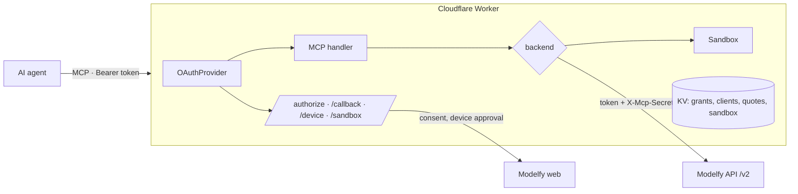

# Modelfy MCP

An [MCP](https://modelcontextprotocol.io) server that lets any AI agent create product photos with [Modelfy](https://modelfy.ai): Claude, ChatGPT, Codex, Cursor, a bot built on any model API, or your own agent.

```
https://mcp.modelfy.ai/mcp
```

It runs on Cloudflare Workers. People connect once and are not asked to sign in again; agents get keys without anyone copying them; and no credit is spent without consent.

## What an agent can do

| Tool                                                     | What it does                                                               | Spends credits |
| -------------------------------------------------------- | -------------------------------------------------------------------------- | -------------- |
| `get_account`                                            | Balance, plan, price per photo; for live keys the budget and today's spend | no             |
| `list_models` · `list_backgrounds` · `get_photo_options` | The catalog: people, places, formats, shot types                           | no             |
| `add_product_photos`                                     | Product photos from public image links                                     | no             |
| `create_upload_session` · `get_uploaded_photos`          | Photos from code (presigned PUT) or from a page a person opens             | no             |
| `plan_photos`                                            | Plans a session and returns its exact price and a `quote_id`               | no             |
| `generate_photos`                                        | Launches the planned session (needs the quote)                             | **yes**        |
| `get_photo_session`                                      | Progress and finished photos; can wait until done                          | no             |
| `list_recent_photos` · `cancel_photo_session`            | Recent photos; stop a session (unstarted photos are refunded)              | refunds        |

The server sends its own instructions on connect, tailored to the kind of connection, and every error carries a stable `code`, a `next_step` the agent can act on and a `docs_url`.

## Connecting

| How                                                                          | For                                                    | What happens                                                                                                                                                                                              |
| ---------------------------------------------------------------------------- | ------------------------------------------------------ | --------------------------------------------------------------------------------------------------------------------------------------------------------------------------------------------------------- |
| **OAuth 2.1** (dynamic registration or client ID metadata documents, PKCE)   | claude.ai, Claude Desktop, ChatGPT, Claude Code, Codex | The person signs in on the Modelfy web and allows the assistant. Access tokens last an hour; refresh tokens have no fixed end and expire only after 90 idle days. Registered clients are never forgotten. |
| **Anonymous sandbox key** — `POST /sandbox/keys`                             | Any agent, no account                                  | A free `mfy_test_…` key. The whole flow works with sample photos; nothing is spent. 5 keys per hour per address, 300 calls per hour per key.                                                              |
| **Device login** (RFC 8628) — `POST /device/code`, then `POST /device/token` | Coding agents and bots that need a real key            | The agent shows the person a link; they approve on the Modelfy web (test key, or live key with a budget) and the agent receives the key.                                                                  |
| **API key by hand**                                                          | Anyone who prefers it                                  | Created in the Modelfy account and sent as `Authorization: Bearer mfy_live_…`.                                                                                                                            |

```sh
# Try it in ten seconds: a sandbox key, then any MCP client
curl -X POST https://mcp.modelfy.ai/sandbox/keys
```

## Spending consent

Every session is planned first (`plan_photos`): the server keeps the exact plan as a quote, bound to the connection, for 30 minutes. `generate_photos` launches only a quote, with the quote as the idempotency key, so a retry never charges twice.

- **OAuth (a person in a chat):** `generate_photos` needs `user_confirmed: true`, which the instructions tell the agent to set only after the person agrees to the price.
- **Live key (a bot):** no confirmation, but each key has a budget per photo session and per UTC day, enforced by the Modelfy API inside the same transaction that reserves the credits.
- **Test and sandbox keys:** never reach a paid route.

## Architecture



- `@cloudflare/workers-oauth-provider` is the authorization server and checks every token; `agents`' stateless `createMcpHandler` serves Streamable HTTP with a fresh `McpServer` per request.
- Tools talk to a `PhotoBackend`: `ApiBackend` (the Modelfy API, with the user's token and the Worker's shared secret) or `SandboxBackend` (the real catalog, everything else canned).
- The Modelfy API accepts these tokens only from this Worker (shared secret), on an exact list of routes; there is no public REST API.

## Development

```sh
npm ci --legacy-peer-deps
cp .dev.vars.example .dev.vars
npm run dev          # wrangler dev on http://localhost:8787
npm test             # Vitest inside the Workers runtime
npm run typecheck && npm run lint
```

Strict TypeScript, no `any`, no type assertions: every API answer is parsed with zod before it is used.

## Deploy

```sh
npx wrangler kv namespace create OAUTH_KV --env dev   # put the id in wrangler.jsonc
npx wrangler secret put MCP_SERVER_SECRET --env dev   # the same value as the API's
npx wrangler secret put SANDBOX_ACCOUNT_KEY --env dev # a test key of the sandbox account
npm run deploy:dev
```
